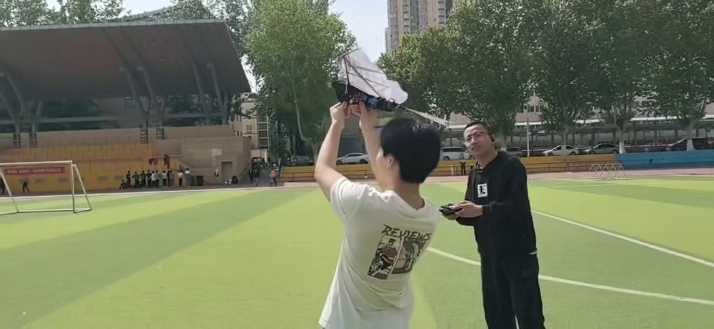

# 大载重仿生扑翼无人机设计

围绕仿生扑翼无人机的结构、扑翼驱动与飞行控制开展设计研究。本仓库用于展示项目视频和简要介绍。

## 飞行视频

[](media/flight-demo.mp4)

**[查看 / 下载完整视频](media/flight-demo.mp4)** · 约 26 秒 · MP4

视频记录了样机手抛放飞及后续飞行画面。点击封面或上方链接打开视频文件。

## 项目简介

项目以提高扑翼平台的有效载荷能力为研究目标，关注以下方向：

- **结构与传动**：机体布局、扑翼驱动机构与轻量化设计。
- **翼面与气动**：柔性翼面、扑翼运动与升力特性。
- **控制与验证**：飞行控制方案、仿真分析与试验验证。

当前展示材料为飞行视频；载重、续航及优化效果等量化指标，待实测数据完善后补充。

## 仓库内容

```text
.
├── README.md               # 项目介绍
└── media/
    ├── cover.jpg           # 视频封面
    └── flight-demo.mp4     # 原始飞行视频
```
